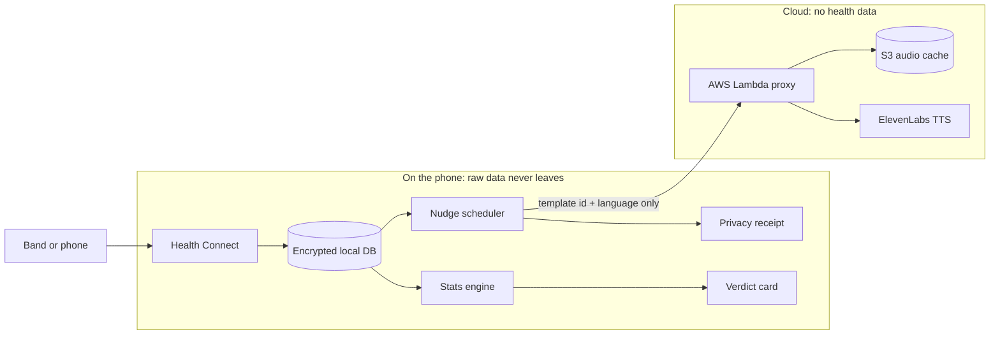

# Architecture

| Block | Status |
|---|---|
| Stats engine, verdict card, privacy receipt (browser) | Built: `engine.js`, `index.html` |
| Lambda proxy to ElevenLabs | Code and mocked tests: `cloud/nudge-proxy.js`; not yet run against the live API |
| Health Connect, encrypted DB, scheduler (Android) | Planned |
| S3 audio cache, Bedrock explanations | Planned |

## How a verdict is computed
1. A randomised plan alternates habit-on and habit-off blocks (3 cycles × 3+3 nights), shuffled within each cycle.
2. Only nights where the plan was followed count (adherence is reported).
3. Effect = mean(on) − mean(off). A bootstrap (5,000 resamples, seeded) gives a 95% range.
4. *Likely helps* needs the whole range above 0 and an effect of at least 15 min (an assumption). *No meaningful effect* needs the whole range within ±15 min. Anything else is *Not enough evidence*.
